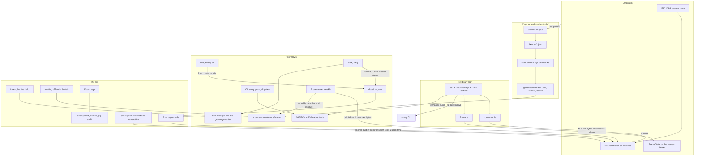

# Assay

Assay proves facts about Ethereum from one 32-byte root. An account's
balance, a storage slot, a transaction's outcome, an event log, a
validator's record, a block root from yesterday or from 2023. Every proof
is pure hashing from the beacon root the protocol itself publishes, with
no oracle, no indexer and no signer in the middle. The verifier is
written in Fe, runs as a contract on Ethereum mainnet today, and the same
code runs as a native binary and in a browser tab.

**The pitch in one sentence.** Assay proves any fact about Ethereum,
any age, from one 32-byte beacon root, in Fe that is deployed on
mainnet, verified live by anyone's browser, and provably the pinned
compiler's own output.

Entry FE-024 in the Fe Builders Challenge. The declaration of starting
point and third-party code is in [SUBMISSION.md](SUBMISSION.md).

## Verify everything

Every claim in this README has a public check behind it.

- **The live site** at [bomanaps.github.io/assay](https://bomanaps.github.io/assay/)
  shows the daily harvest of proven mainnet facts, and its
  [Run page](https://bomanaps.github.io/assay/run.html) lets you fire
  real verifications at the mainnet contract and prove your own facts,
  with your browser doing the preparation and Ethereum doing the
  verifying.
- **The contract** is live at
  [`0xDd356690270534B0DCe6755d77bCA554c9c54603`](https://etherscan.io/address/0xDd356690270534B0DCe6755d77bCA554c9c54603).
  Its first transaction
  [proved a USDC storage slot on chain](https://etherscan.io/tx/0x7f949f53417c31737c5cf0ba524153f8ead9e6a608dbf1d7c6dec9e9faa38316)
  for 599,273 gas. The full story, with the earlier deployment, is in
  [docs/deployment.md](docs/deployment.md).
- **The bytecode is provably Fe's output.** The
  [Provenance workflow](https://github.com/bomanaps/assay/actions/workflows/provenance.yml)
  downloads the pinned Fe compiler, rebuilds this source, and fails
  unless the bytes on mainnet match. A second job builds the Fe compiler
  itself from source and reproduces the browser module's exact hash.
  Its runs are public, it reruns in any fork of this repository, and
  `FE=<fe-binary> python3 tools/verify_build.py` is the same mainnet
  check as one local command.
- **The pipelines are public.** Every six hours a workflow captures fresh
  proofs at the mainnet head and re-checks them against the live
  contract. Every day another one proves about 1,500 fresh accounts and
  their storage from one beacon root. Their logs and commits are the
  receipts.

## What it proves

| Fact | How | Where to see it |
|---|---|---|
| Storage and accounts | beacon root to execution state root to the two tries | [Run page](https://bomanaps.github.io/assay/run.html), `src/storage.fe` |
| Transaction outcomes and logs | the block's receipt trie, anchored through the beacon root | Run page, `src/receipt.fe` |
| Whole payloads | one 14-helper multiproof, 17 hashes instead of 48 | Run page, `src/beacon.fe` |
| Validator records | fifty hash levels into the registry | Run page, `src/beacon.fe` |
| Any post-Capella block root | the state's 8,192-slot window, or the frozen historical summaries for 2023 | Run page, `docs/frames.md` for the Gloas variant |
| Post-quantum state and signatures | the draft quantum fork's own containers, and leanXMSS verified in Fe | [docs/pq.md](docs/pq.md), the Run page frontier |
| Frame transactions | a proof-gated payment frame, run against the next fork's devnet | [docs/frames.md](docs/frames.md) |

## Approach and architecture

The approach is one trust chain used everywhere. The EIP-4788 contract
hands the EVM a beacon block root. SSZ branches walk from that root to
the execution state root, the receipts root, a validator, or an older
block root. Merkle-Patricia walks continue into accounts, storage and
receipts. Every step is a hash comparison, so the verifier needs no
keys, no signers and no trusted data source, and the same property is
why it survives the planned post-quantum fork unchanged.

One Fe library carries the whole chain, and everything else is a thin
consumer of it.

```
src/            the verifier library, SSZ + trie + receipts + XMSS
├── consumer.fe   BeaconProver, the contract deployed on mainnet
├── frame.fe      FrameGate, the devnet frame transaction gate
└── example.fe    ValidatorGate, the worked consumer example
cli/            the same library as a native binary
wasm/           the same library compiled for the browser
tools/          capture, oracles, generators, every CI gate
docs/           the site, including the Run page and this evidence
```

The compile targets share the verification code. A fact proven by the
mainnet contract, the CLI and a browser tab is proven by the same Fe
functions three times.

How every piece feeds the next, from capture to a visitor's click.



## The Fe highlight

Generalized indices, the coordinates of SSZ proofs, are computed at
compile time and pinned by assertion, so a wrong beacon layout is a
compile error rather than a runtime surprise. This is the function that
walks the new progressive container layout, written days after the
devnet started running it.

```fe
pub const fn progressive_field(_ fields: u256, _ index: u256) -> u256 {
    if index >= fields {
        core::panic_code(PANIC_ASSERT)
    }
    var depth: u256 = 0
    var gindex: u256 = 2
    var remaining = index
    while remaining >= (1 << depth) {
        remaining -= 1 << depth
        depth += 2
        gindex = gindex * 2 + 1
    }
    ((gindex << 1) << depth) + remaining
}

static_assert(progressive_field(46, 24) == 2947)
static_assert(GLOAS_LATEST_BLOCK_HASH == 23427)
```

The committed fixture and an independent Python oracle both confirm
those numbers against the live chain, and the browser module runs this
exact function today.

## The evidence discipline

Every proof path in this repository clears the same bar before it is
called done. A fixture captured from a real network. An independent
Python oracle that shares no code with the Fe verifier and must agree.
Tamper tests that flip bytes, reuse branches and truncate proofs, each
refused for its named reason. Both compile targets, EVM and native, with
the same verdicts. Right now that is 165 EVM tests, 130 native tests, a
65-row CLI matrix, 12 committed attack vectors, 40 leanXMSS signature
vectors agreed byte for byte with Ethereum's formally verified EthLib,
and a browser module that reproduces every one of those verdicts.
[docs/audit.md](docs/audit.md) describes what we checked, what we found
on the way, and what we deliberately do not claim.

## Build and test

With the pinned Fe release (v26.6.0) and Python 3:

```
fe check .
fe test .
fe test --backend native .
python3 -I tools/gen_fixtures.py check
python3 -I tools/run_vectors.py <assay-cli-binary>
```

Build the CLI with
`fe build --backend native -O 2 --emit executable --out-dir out cli`.
The capture tools need two Python packages, installed with
`pip install -r tools/requirements-capture.txt`. Then one command
captures a fresh proof at the mainnet head, verifies it locally with the
same code the contract runs, and prints a ready mainnet call

```
python3 -I tools/prove.py out/assay <address> [slot]
```

To use Assay from your own Fe contract, the worked guide is
[docs/consuming.md](docs/consuming.md). Twenty lines gets you a contract
that acts only on proven facts.

## Pins

Moving parts are pinned, and gates in CI hold every pin.

| What | Pinned to |
|---|---|
| Fe compiler | [v26.6.0](https://github.com/argotorg/fe/releases/tag/v26.6.0), and master [`2e9a011df`](https://github.com/argotorg/fe/commit/2e9a011df58732d94ee342819f9e95998a638a75) for the browser module only |
| Consensus spec | [`5165fa36`](https://github.com/ethereum/consensus-specs/commit/5165fa360f90f1ea450fd6cd34b29e7da5a4bcc2), which reproduces live state roots byte for byte |
| EIP-8141 text | [`dc5d5fa6`](https://github.com/ethereum/EIPs/blob/dc5d5fa688b7fe87b95a907fcc128b4fde2f4d2f/EIPS/eip-8141.md), the revision the frame gate implements |
| Post-quantum spec | [`b5d422b2`](https://github.com/ethereum/consensus-specs/commit/b5d422b255db80c9bbc48f515370655ecc8bf6e5), the commit the PQ fixture records |
| EthLib vectors | [`dc0581d3`](https://github.com/ethereum/EthLib/commit/dc0581d386cab73edd70b46681ba3f529875d80c), re-downloaded and diffed in CI |

## Limitations

- Proofs reach back to the Capella fork and no further. Older roots live
  in a structure the chain froze.
- Live verification needs a beacon root younger than about 27 hours, the
  depth of the 4788 ring buffer. The pipelines keep one supplied.
- The receipt decoder fails closed on transaction types above 4.
- The frame gate and the post-quantum work implement pinned revisions of
  moving drafts, and say which ones.
- Fe has no fuzzer yet, so adversarial coverage is the committed vector
  suites and tamper tests rather than random exploration.
